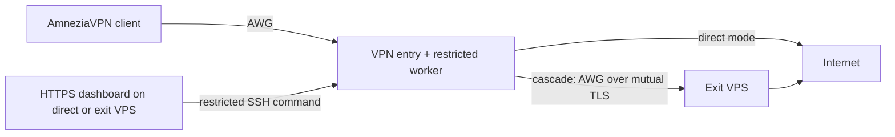

# Architecture / Архитектура

The web app is Flask + SQLite behind nginx. Its SSH key is restricted to a
single command and source address. The worker changes only portal-owned peers,
keeps encrypted private state and enforces pause/expiry/quota with a 15-second
systemd timer. The web container does not mount the Docker socket.

The collector samples transfer counters; lifetime totals are independent of
chart retention. Recent samples are bounded and older charts use daily totals.
No browsing history or packet contents are stored by the dashboard.

Direct/cascade labels are configurable at render time; no deployment address
is embedded in the public source. The portable component can prepare a panel
for an existing compatible AWG entry, but does not construct a tunnel itself.
The outer installer constructs a **new** topology and refuses an existing one.

Pause or automatic restriction changes worker state without issuing replacement
client profiles. Revoking removes a portal-owned client; protected pre-existing
profiles are not silently adopted or revoked.

Панель обслуживает один VPN-вход. Счётчики за всё время не зависят от очистки
графиков. Состояние существующего VPN нельзя переносить на другой сервер
подменой адресов: требуется отдельный согласованный план миграции.
