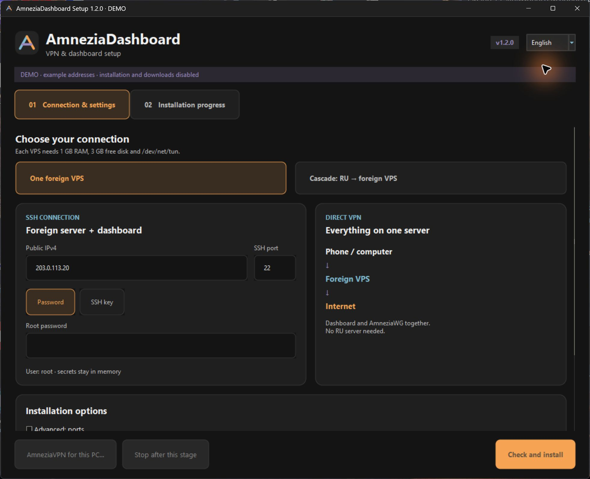
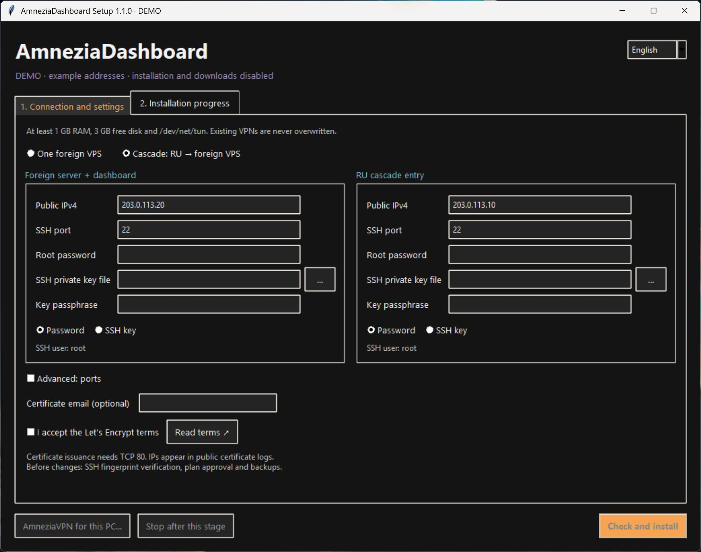
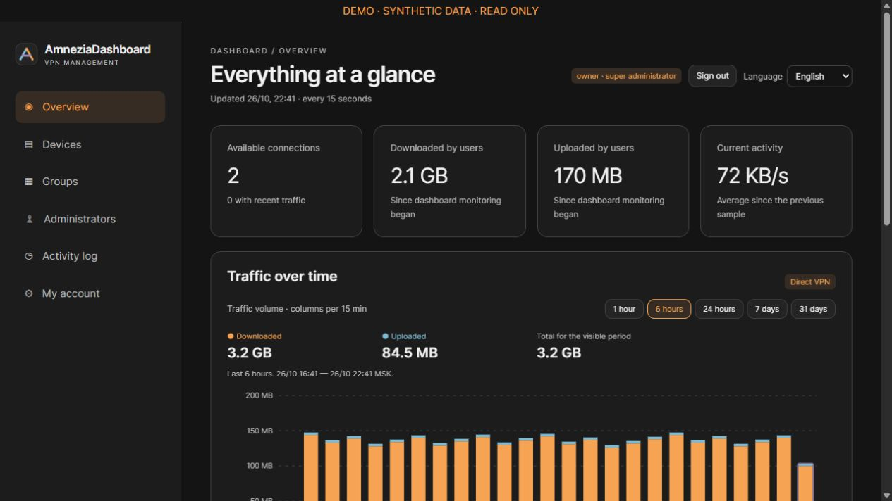
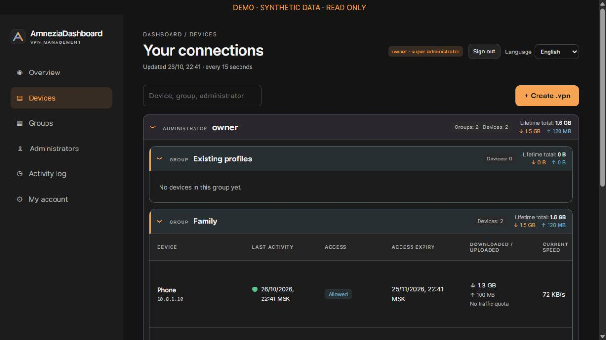
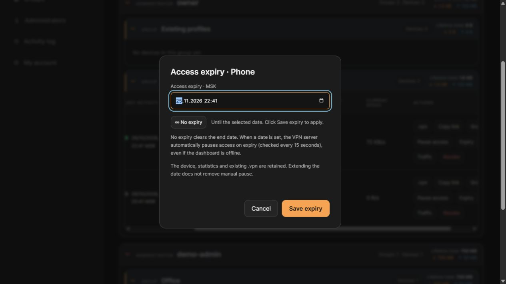
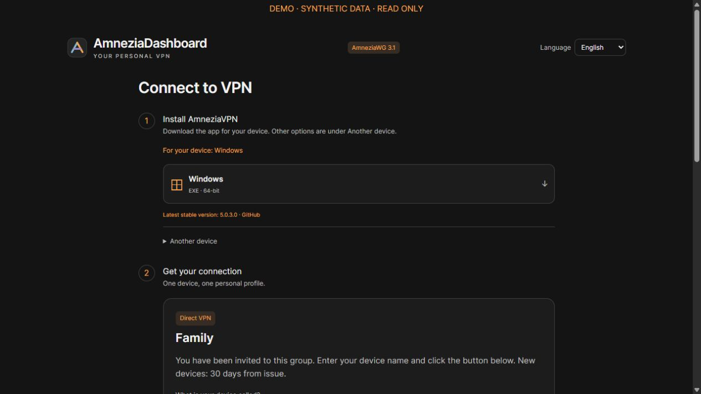
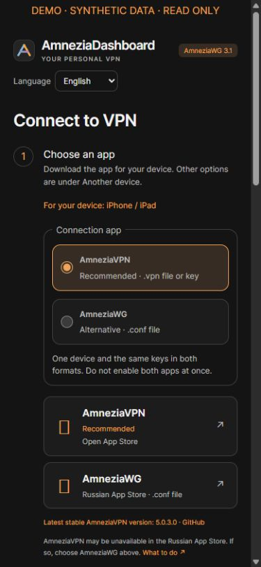

# Installing AmneziaDashboard 1.3.0

[Русский](INSTALL_RU.md) · [Home](../README.md) · [Releases](https://github.com/AstolfoSan/AmneziaDashboard/releases)

> [!WARNING]
> This is a **first-install wizard for fresh VPSs**. Do not run it over a working VPN.
> Source tests and the Windows application are checked, but full clean-VPS and real iOS/Android acceptance still require separate testing. See [VALIDATION.json](../VALIDATION.json).

## 1. Choose your topology

**Direct VPN — one foreign VPS.** Devices connect straight to it; the dashboard lives on the same host. This is the simplest starting point.

**Cascade — two VPSs.** Device → entry VPS (for example, in RU) → foreign VPS → Internet. The dashboard lives on the foreign host, while issued profiles connect to the entry. The inter-server connection carries AmneziaWG inside mutually authenticated TLS. An unavailable foreign tunnel must not fall back to a direct RU exit.

One dashboard manages one VPN entry. It is not a multi-exit selector inside one profile.

## 2. Prepare your VPSs

For each server:

1. In your hosting control panel, create a **new Ubuntu 24.04 LTS VPS** with a public IPv4. Do not reinstall an existing production VPN.
2. Minimum: 1 GB RAM, 3 GB free disk and available `/dev/net/tun`. Recommended: 2 GB RAM and 5 GB free disk.
3. Keep the IP, SSH port (usually 22), and **root** password or private SSH key ready. A `.pub` file is not a private key.
4. Keep access to the provider's recovery console. A provider snapshot is useful, but does not replace private backups.
5. Open the following ports in the **provider firewall / security group**. The wizard cannot change your hosting account's network firewall.

| Host | Default port | Purpose |
| --- | --- | --- |
| Every VPS | TCP 22, or your SSH port | Installer administration |
| VPN entry | UDP 39265 | VPN client connections |
| Foreign dashboard host | TCP 10443 | Dashboard HTTPS |
| Foreign dashboard host | TCP 80 | HTTPS issuance and renewal |
| Foreign host, cascade only | TCP 443, from entry IPv4 only | Inter-server TLS |

In direct mode, the first four rows refer to the same host. Keep TCP 80 open for automatic renewal. If changing ports, match the provider firewall to the wizard settings.

Servers need access to Ubuntu, Docker, GitHub, official Amnezia sources and Let's Encrypt. Home routers, NAT-only VPSs without public IPv4 and Windows Server deployment targets are not supported.

## 3. Download the Windows application

On your **Windows 10/11 x64 computer**, not the VPS:

1. Open the [latest GitHub release](https://github.com/AstolfoSan/AmneziaDashboard/releases/latest).
2. Under **Assets**, download **AmneziaDashboardSetup.exe** and **SHA256SUMS** from the same release.
3. Optionally download **Windows-licenses.zip**, containing bundled-component licenses.
4. Check the repository address is exactly `github.com/AstolfoSan/AmneziaDashboard`.

Python, the SSH library and runtime dependencies are **already included** in the EXE. You do not need to install Windows dependencies yourself. VPS dependencies are installed automatically after your approval.

Open PowerShell in the download folder and run:

```powershell
Get-FileHash .\AmneziaDashboardSetup.exe -Algorithm SHA256
```

Compare Hash to the SHA256SUMS line ending in `AmneziaDashboardSetup.exe`. **Do not run the file if they differ.** A checksum verifies integrity, not the trustworthiness of its source.

The EXE is currently **unsigned**. Any Windows/antivirus warning decision belongs to you; do not disable protection to install it. You can instead inspect the source and use the terminal method below. Configuring VPSs over SSH does not require local Windows administrator rights.

## 4. Open the wizard and enter settings

1. Double-click the EXE. First launch may take a few seconds while the embedded runtime extracts. The window is shown after its layout is ready, rather than assembling controls in front of you.
2. Select **English** in the upper-right corner. The web dashboard has its own selector and remembers your choice in the browser.
3. Select **One foreign VPS** or **Cascade: RU → foreign VPS**.
4. Under **Foreign server + dashboard**, enter the IPv4 and SSH port.
5. Select an authentication method:
   - **Password**: enter the root password.
   - **SSH key**: use “…” to select your private key, and enter its passphrase if applicable. The root password field is ignored in this mode.
6. For cascade, fill in **RU cascade entry** as well.
7. Keep default ports unless necessary. Change them under **Advanced: ports**.
8. Certificate email is optional.
9. Click **Read terms** and review the Let's Encrypt terms. Check the box only if you agree. The dashboard IP is sent to the CA and appears in public Certificate Transparency logs.
10. Click **Check and install**.

These are real application screenshots in safe DEMO mode: example addresses only, with SSH installation and downloads disabled.

The wizard matches the dashboard: dark cards and blue, purple and orange accents. **Password / SSH key** shows only the relevant fields without losing typed values. On smaller screens, scroll the central form; the main actions remain fixed below it. Ports are inside **Advanced: ports**; the inter-server TLS port is shown only for cascade mode.





Root passwords and key passphrases remain in process memory, not command-line arguments or public packages. Do not share screenshots of filled secret fields.

## 5. Verify hosts and approve the plan

1. The wizard displays each new server's **SSH fingerprint**. Compare it through a trusted connection or hosting console. For example, in the VPS console:
   `ssh-keygen -lf /etc/ssh/ssh_host_ed25519_key.pub -E sha256`.
2. Decline if the fingerprint differs or cannot be verified. Never disable host-key verification.
3. Review the exact entry, foreign server, ports and dashboard URL. Approve changes only after checking the targets.

The wizard then:

- inventories OS, resources, TUN, occupied ports, routes and existing VPN state;
- discovers current official upstream releases and locks selected commits/image digests;
- creates and verifies private pre-change recovery snapshots;
- installs Docker/dependencies, AmneziaWG and the dashboard; cascade also gets an inter-server transport;
- creates new keys, restricted worker SSH access, HTTPS and enforcement/renewal timers;
- runs its built-in readiness gates.

Watch **Installation progress**. Keep your computer and the application running. **Stop after this stage** requests ownership-scoped cleanup after the current stage; it is not a complete VM rollback.

If preflight finds an existing VPN or occupied port, **do not delete its files or stop another service** to proceed. Choose a fresh VPS or prepare a separate migration plan.

## 6. Sign in for the first time

1. After successful completion, click **Open dashboard**.
2. The URL looks like `https://203.0.113.20:10443/admin` — **use the actual URL shown in your result**, not this example.
3. Sign in as **owner**. The initial password is in **result-private.json**, inside the private result directory reported by the wizard. Read it locally; never post it in chat or GitHub.
4. Open **My account → Change password** and set your own long password.
5. Check the **Language** selector. Administrator/group/device names are not translated. Expiry and chart times remain explicitly Moscow time, MSK.



## 7. Create a group and issue the first profile

1. If needed, open **Administrators → + Administrator**, create a separate account and set its device limit. Do not share owner.
2. Open **Groups → + Create group**.
3. Enter a name, select the administrator, device limit and default access duration. Blank means unlimited; this default applies only to newly issued profiles.
4. Click **Copy invitation** and send it to the intended person. Invitations are currently reusable: any holder can issue profiles within the group limit.
5. Alternatively, open **Devices → + Create .vpn**, choose the group and name the device.
6. Its row offers **.vpn**, **.conf**, **Copy link**, **Pause access**, **Expiry** and **Traffic**.



**One profile per device.** Pause, expiry and quota retain the profile for later reuse. **Revoke** removes access; it is not a temporary pause. Closing an administrator account does not itself disconnect previously issued profiles.

For unlimited duration: **Expiry → ∞ No expiry → Save expiry**. Remove manual pause separately if needed. Traffic quota counts both downloaded and uploaded lifetime usage since monitoring began; lifetime counters are not reset.



## 8. Install the VPN client and connect

**On this Windows PC:** the wizard has a separate **AmneziaVPN for this PC…** button. It downloads the latest stable Windows x64 installer from official GitHub, requires and verifies its official SHA-256, then opens the normal AmneziaVPN installer. Complete the vendor setup and any Windows confirmations yourself. This is independent of VPS provisioning.

**On a phone or another computer:**



1. Open your group invitation.
2. The first step detects your OS and shows only matching downloads: Android APK / Google Play, iPhone/iPad App Store, Windows, macOS or Linux. Open **Another device** if detection is wrong or you need a different device. Unknown systems retain all manual choices. Direct downloads still resolve the latest stable official AmneziaVPN release.
3. Install the application.
4. Return to the invitation, name the device and click **Get connection**.
5. Click **Add to AmneziaVPN**, then confirm import in the app. iOS may show Share: choose AmneziaVPN.
6. If native import is unavailable, download and open `.vpn`, or click **Copy key**.
7. For manual import: AmneziaVPN → **+** → paste the key → **Paste** → confirm → connect.


The two cropped upstream images show the Russian AmneziaVPN UI; positions correspond to Plus and Paste. Native import depends on OS/browser support. Download and copy remain fallbacks. Do not share personal profiles.

### AmneziaWG and .conf profiles

On iPhone/iPad, step one offers **AmneziaVPN (recommended)** or **AmneziaWG**. AmneziaWG has an [official Russian App Store listing](https://apps.apple.com/ru/app/amneziawg/id6478942365). Use a version supporting AWG 3.1 (3.1.4 or later at release time). On Android, Windows, macOS and Linux, expand **AmneziaWG — additional option**; alternative installation links are also collapsed.



1. Choose and install your app in step one.
2. Get the invitation profile as usual. Do not create a second device.
3. For AmneziaVPN, use **Add to AmneziaVPN**, a `.vpn` file or the key.
4. For AmneziaWG, use **Add to AmneziaWG** and select it in the system share sheet, when supported. Otherwise select **Download .conf for AmneziaWG**.
5. Import the tunnel from that file in AmneziaWG. On iPhone, you can also use Files → Share → AmneziaWG. Confirm import and enable the tunnel.

Administrators get a **.conf** button next to **.vpn**. Both formats use the same device identity, address, keys, endpoint, MTU, AWG 3.1 parameters, expiry, manual pause and traffic quota. DNS placeholders in the native export become concrete DNS addresses for standalone import. Export never creates a peer or restores revoked access. Protected legacy profiles without a stored guest export remain non-downloadable.

Do not enable both apps at once or reuse the profile on another device. A `.conf` contains its private client key: treat it like a password. This is **not** a standard WireGuard profile. Changing the app does not fix provider/network path problems. Native sharing depends on the actual device and browser; physical iOS/Android acceptance is not claimed.

## 9. Backups, recovery and troubleshooting

Windows: `%LOCALAPPDATA%\AmneziaDashboardInstaller\sessions\<id>`.
Linux/macOS: `~/.local/share/AmneziaDashboardInstaller/sessions/<id>` if LOCALAPPDATA is unset.
The CLI supports a custom private directory with `--home`.

It contains private stage journals, before/after snapshots and the initial password. Root-only VPS copies are under `/root/amnezia-dashboard-installer-<id>`. Keep a protected off-host copy. **Never upload any of these directories to GitHub.**

| Symptom | Next check |
| --- | --- |
| SSH timeout | Correct IP/port, provider firewall, recovery console connectivity |
| Authentication failed | Root password, correct private key and its passphrase |
| Preflight refusal | Fresh Ubuntu 24.04, RAM/disk, TUN and occupied ports |
| GitHub/Docker failure | Official-source connectivity, DNS; do not substitute random mirrors |
| Certificate issuance failure | Public IPv4, external TCP 80, port conflicts and CA rate limits |
| HTTPS warning | Do not bypass it; check URL, clock and certificate |
| Dashboard unavailable | Correct HTTPS URL, TCP 10443 firewall, final completed stage |
| Imported profile but no traffic | Entry UDP firewall, cascade transport, device pause/expiry/quota |
| Client download failure | GitHub availability, official digest and supported x64 asset; install from the official vendor independently if necessary |
| Interrupted installation | Preserve the private directory; do not rerun over partial state |

Stop/rollback is best-effort and limited to objects owned by that session. Lost SSH can prevent cleanup. Snapshots are not complete disk images. Never restore an old database over newer devices or traffic totals. Inspect the recorded stage and prepare recovery first.

## 10. Terminal method, Linux/macOS and source builds

The ready EXE is preferred for Windows. For source installation, download **AmneziaDashboard.zip**, verify its own SHA256SUMS line and extract the entire archive. The repository root contains VERSION.

Windows with Python 3.12+:

```powershell
py -3 -m venv .venv
.\.venv\Scripts\python.exe -m pip install -r installer\requirements.txt
.\.venv\Scripts\python.exe installer\cli.py --self-test
.\.venv\Scripts\python.exe installer\cli.py --lang en
```

Linux/macOS with Python 3.12+:

```sh
python3 -m venv .venv
.venv/bin/python -m pip install -r installer/requirements.txt
.venv/bin/python installer/cli.py --self-test
.venv/bin/python installer/cli.py --lang en
```

Run the wizard on your operator computer; it connects over SSH. Never pass credentials through pipes, files, command-line arguments or public web forms. English CLI plan confirmation requires **INSTALL** exactly. Russian (`--lang ru`) requires **УСТАНОВИТЬ**. Blank confirmation means no.

## 11. Future releases and existing deployments

Download future versions from GitHub Releases and verify SHA256SUMS from the **same release**. The `releases/latest` links follow the newest published stable release.

Moving dashboard 1.0.0 → 1.1.0 does not require replacing VPN keys, profiles or its database: this release changes presentation and installer features. However, automatic live-server upgrades are not implemented. Prepare a verified private backup and compatible code/image update plan. **Do not use the fresh installer as an updater.**

Dashboard/wizard screenshots were captured locally with synthetic DEMO data, not production servers. They are not proof of a complete VPS deployment.
