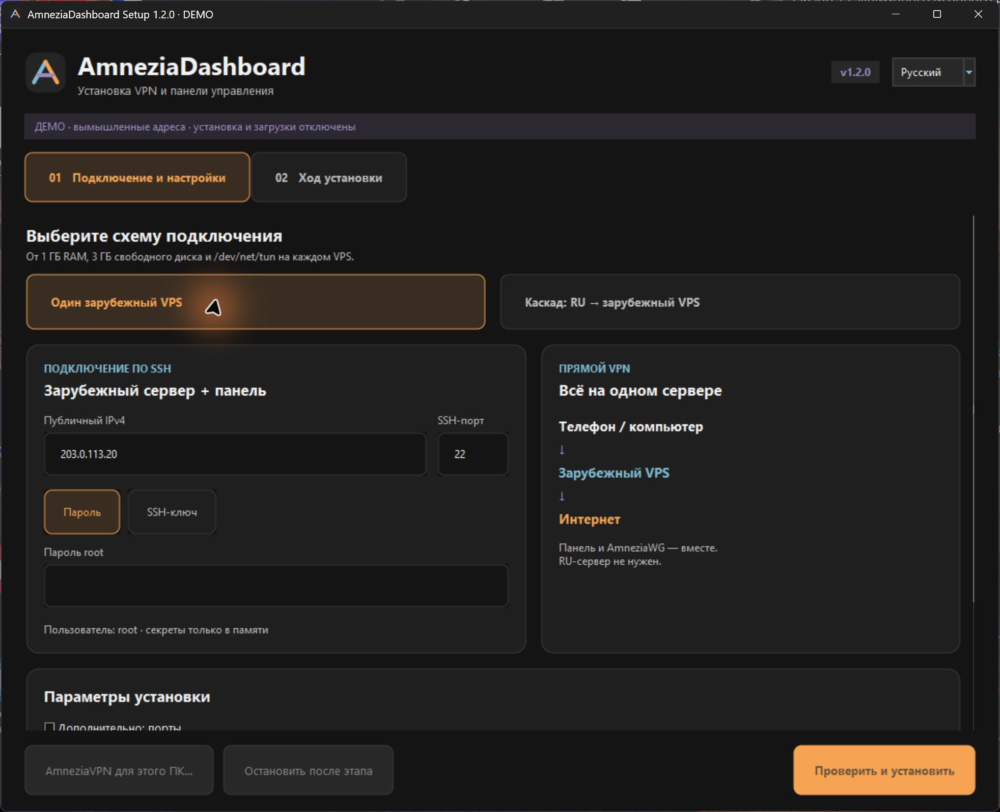
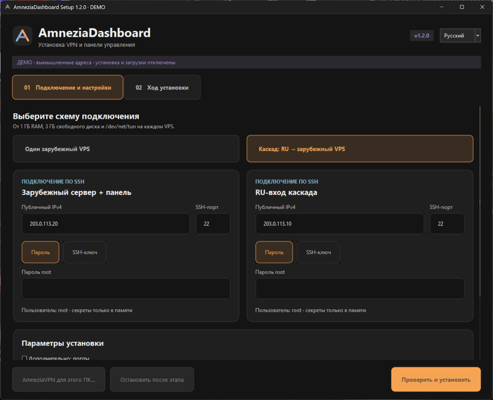
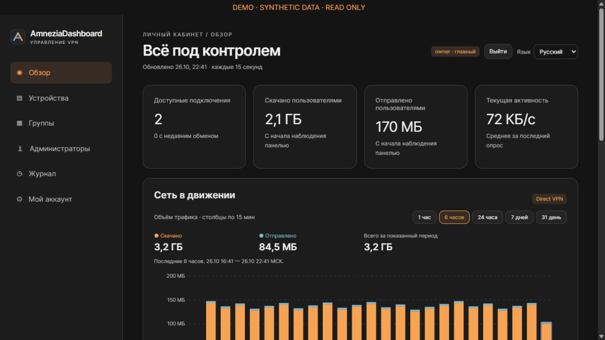
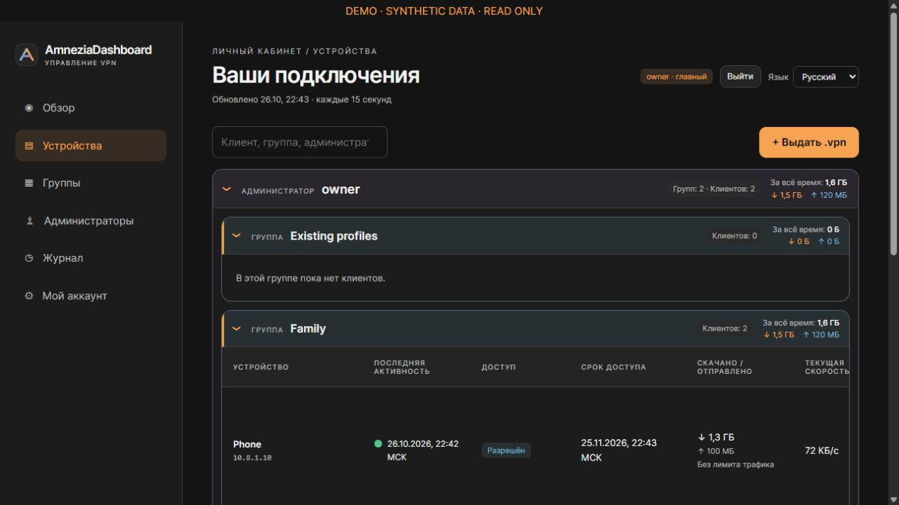
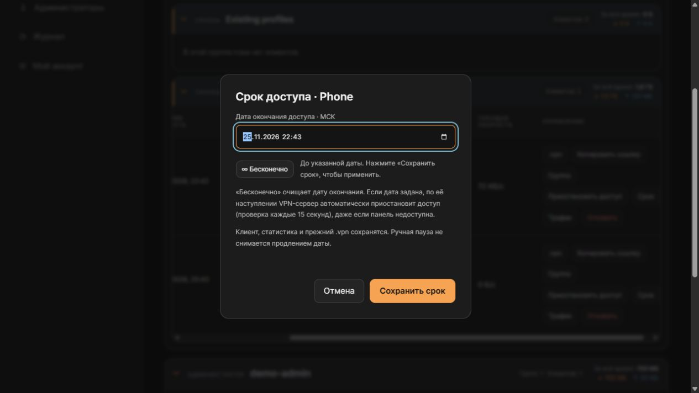
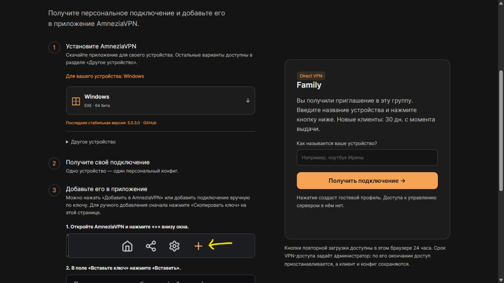
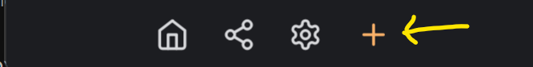
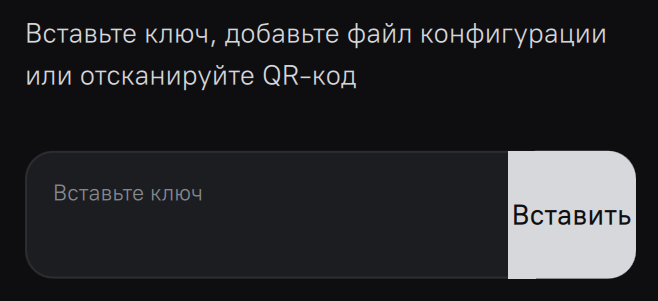

# Установка AmneziaDashboard 1.2.0

[English](INSTALL_EN.md) · [Главная](../README_RU.md) · [Все версии](https://github.com/AstolfoSan/AmneziaDashboard/releases)

> [!WARNING]
> Только первая установка на **новые чистые VPS**. Не запускайте мастер на сервере с действующим VPN.
> Проверки исходников и Windows-программы пройдены, но полная установка на чистых VPS и реальные iOS/Android ещё требуют отдельной проверки. См. [VALIDATION.json](../VALIDATION.json).

## 1. Выберите схему

**Прямой VPN — один зарубежный VPS.** Телефон или компьютер подключается сразу к нему. Панель также находится на нём. Для начала это самый простой вариант.

**Каскад — два VPS.** Клиент → входной RU VPS → зарубежный VPS → Интернет. Панель находится на зарубежном, а профили подключаются к RU-входу. Межсерверный канал использует AmneziaWG внутри взаимно аутентифицированного TLS; при его отказе прямого выхода через RU быть не должно.

Одна панель управляет одним VPN-входом. Это не выбор из нескольких зарубежных выходов в одном профиле.

## 2. Подготовьте серверы

Для каждого сервера:

1. В панели вашего хостинга создайте **новый VPS с Ubuntu 24.04 LTS** и публичным IPv4. Не переустанавливайте существующий VPN-сервер.
2. Минимум: 1 ГБ RAM, 3 ГБ свободного диска, доступный `/dev/net/tun`. Рекомендуется 2 ГБ RAM и 5 ГБ свободного диска.
3. Сохраните IP, SSH-порт (обычно 22) и пароль **root** либо путь к приватному SSH-ключу. Файл `.pub` не подходит.
4. Оставьте доступ к аварийной консоли хостинга. Снимок VPS у хостера полезен, но не заменяет резервные копии.
5. Откройте порты ниже в **сетевом firewall хостинга / security group**. Мастер не умеет менять настройки личного кабинета хостинга.

| Где | Порт по умолчанию | Для чего |
| --- | --- | --- |
| Каждый VPS | TCP 22 или ваш SSH-порт | Доступ установщика |
| VPN-вход | UDP 39265 | Подключения клиентов |
| Зарубежный VPS с панелью | TCP 10443 | Панель в браузере |
| Зарубежный VPS с панелью | TCP 80 | Выпуск и продление HTTPS |
| Зарубежный VPS, только каскад | TCP 443, только с IP RU-входа | Межсерверный TLS |

В прямой схеме все первые четыре строки относятся к одному серверу. Не закрывайте TCP 80 после установки: он нужен автопродлению. При других портах укажите их и в firewall, и в мастере.

Серверы должны иметь доступ к Ubuntu, Docker, GitHub, источникам Amnezia и Let’s Encrypt. Домашний роутер, NAT без публичного IPv4 и Windows Server как VPS-цель не поддерживаются.

## 3. Скачайте Windows-установщик

На вашем **Windows 10/11 x64**, не на VPS:

1. Откройте [последний релиз GitHub](https://github.com/AstolfoSan/AmneziaDashboard/releases/latest).
2. В разделе **Assets** скачайте **AmneziaDashboardSetup.exe** и **SHA256SUMS** из одного релиза.
3. При необходимости скачайте **Windows-licenses.zip** — лицензии включённых компонентов.
4. Проверьте, что адрес репозитория — `github.com/AstolfoSan/AmneziaDashboard`.

Python, SSH-клиент и библиотеки уже внутри `.exe`. Вручную ставить зависимости на Windows не нужно. На VPS мастер сам установит нужные зависимости после вашего подтверждения.

Чтобы проверить загрузку: в папке с файлом откройте PowerShell и выполните:

```powershell
Get-FileHash .\AmneziaDashboardSetup.exe -Algorithm SHA256
```

Сравните значение Hash с той строкой SHA256SUMS, которая заканчивается на `AmneziaDashboardSetup.exe`. При несовпадении **не запускайте файл**. SHA-256 подтверждает целостность, но не заменяет проверку источника.

Установщик пока **без подписи издателя**. Если Windows или антивирус показывает предупреждение, решение остаётся за вами; не отключайте защиту для установки. Можно использовать проверенный исходный код и терминальный метод ниже. Программа не требует прав администратора Windows для SSH-настройки VPS.

## 4. Откройте мастер и заполните поля

1. Дважды нажмите `.exe`. Первый запуск может занять несколько секунд: распаковывается встроенная среда.
2. Справа сверху выберите **Русский**. Веб-панель имеет собственный переключатель и запоминает выбор в браузере.
3. Выберите **Один зарубежный VPS** либо **Каскад: RU → зарубежный VPS**.
4. В блоке **Зарубежный сервер + панель** введите адрес и SSH-порт.
5. Выберите способ входа:
   - **Пароль**: заполните «Пароль root».
   - **SSH-ключ**: кнопкой «…» выберите приватный файл; укажите пароль ключа, если он есть. Поле пароля root при этом не используется.
6. Для каскада заполните второй блок **RU-вход каскада**.
7. Порты оставьте стандартными, если нет причины менять. Изменить можно в «Дополнительно: порты».
8. Email для сертификата необязателен.
9. Нажмите **Прочитать**, ознакомьтесь с условиями Let’s Encrypt. Поставьте галочку только если согласны. IP панели передаётся центру сертификации и публикуется в Certificate Transparency.
10. Нажмите **Проверить и установить**.

Примеры ниже — настоящий интерфейс в безопасном режиме DEMO. Адреса вымышлены, установка и загрузки отключены.

Мастер оформлен как дашборд: тёмные карточки и синие, фиолетовые, оранжевые акценты. Поля меняются при выборе **Пароль / SSH-ключ**, введённые значения сохраняются при переключении. На небольшом экране прокручивайте центральную форму; основные кнопки внизу остаются на месте. Порты скрыты в **Дополнительно: порты**; порт межсерверного TLS показывается только для каскада.





Пароли root и ключа хранятся только в памяти процесса, не передаются в командной строке и не сохраняются в публичном пакете. Не показывайте заполненные поля другим людям.

## 5. Подтвердите серверы и план

1. Мастер покажет **SSH-отпечаток** каждого нового сервера. Сверьте его через доверенное подключение или консоль хостинга. Например, в консоли VPS можно посмотреть:
   `ssh-keygen -lf /etc/ssh/ssh_host_ed25519_key.pub -E sha256`.
2. Если отпечаток не совпадает или вы не можете его проверить — откажитесь. Не выключайте проверку ключей.
3. Прочитайте план: вход, зарубежный сервер, порты и URL панели. Только затем подтвердите начало изменений.

Затем мастер:

- проверяет ОС, ресурсы, TUN, занятые порты, маршруты и отсутствие существующей VPN-установки;
- получает актуальные официальные версии, закрепляет выбранные коммиты и образы по digest;
- создаёт и проверяет приватные резервные копии до изменений;
- устанавливает Docker и зависимости, поднимает AmneziaWG и панель, а для каскада — межсерверный транспорт;
- создаёт новые ключи, ограниченный SSH-доступ агента, HTTPS и таймеры;
- выполняет встроенные проверки готовности.

Ждите вкладку **Ход установки**. Не выключайте компьютер и не закрывайте программу. «Остановить после этапа» просит завершить текущий этап и остановить только созданную установку; это не полное восстановление диска.

При отказе из-за занятого порта или найденного VPN **не удаляйте его файлы и не останавливайте чужую службу**. Выберите другой новый VPS либо подготовьте отдельный план миграции.

## 6. Первый вход в панель

1. После успешного завершения нажмите **Открыть панель**.
2. Адрес имеет вид `https://203.0.113.20:10443/admin` — **замените пример на адрес из результата**.
3. Логин: **owner**. Первый пароль находится в `result-private.json` в приватной папке с результатами, указанной мастером. Откройте его локально, не отправляйте в чат или GitHub.
4. Войдите, откройте **Мой аккаунт → Изменить пароль**, задайте собственный длинный пароль.
5. Проверьте переключатель **Язык**. Имена администраторов, групп и устройств не переводятся. Время сроков и графиков — московское, МСК.



## 7. Создайте группу и выдайте первый профиль

1. При необходимости: **Администраторы → + Администратор**, создайте отдельный кабинет и лимит устройств. Не раздавайте owner.
2. Откройте **Группы → + Создать группу**.
3. Введите имя, выберите администратора, лимит устройств и срок по умолчанию. Пустой срок — без ограничения. Он применяется только к новым профилям.
4. Нажмите **Копировать приглашение** и передайте его нужному человеку. Сейчас ссылка многоразовая: любой получатель может выпускать профили в пределах лимита группы.
5. Либо откройте **Устройства → + Выдать .vpn**, выберите группу и имя устройства.
6. В строке клиента доступны **.vpn**, **Копировать ссылку**, **Приостановить доступ**, **Срок**, **Трафик**.



**Один профиль — одно устройство.** Пауза, срок и лимит сохраняют профиль для дальнейшего использования. «Отозвать» удаляет доступ; это не временная пауза. Закрытие кабинета администратора само по себе не отключает его клиентов.

Для бессрочного доступа: **Срок → ∞ Бесконечно → Сохранить срок**. Ручную паузу нужно снять отдельно. Лимит трафика учитывает скачанное и отправленное с начала наблюдения панелью; счётчики за всё время не сбрасываются.



## 8. Установите клиент и подключитесь

**На этом Windows-компьютере:** в мастере есть отдельная кнопка **AmneziaVPN для этого ПК…**. Она запрашивает последний стабильный x64 установщик с официального GitHub, проверяет официальный SHA-256 и открывает обычный установщик AmneziaVPN. Завершите его шаги и подтверждения Windows самостоятельно. Серверная установка от этой кнопки не зависит.

**На телефоне или другом компьютере:**



1. Откройте приглашение группы.
2. Первый шаг определяет ОС и показывает только подходящие загрузки: Android APK / Google Play, App Store для iPhone/iPad, Windows, macOS или Linux. Если определение ошиблось или нужен другой компьютер, откройте **Другое устройство**. Для неизвестной ОС сразу доступны все варианты. Прямые файлы по-прежнему выбираются из актуального стабильного релиза AmneziaVPN.
3. Установите приложение.
4. Вернитесь на страницу, задайте имя устройства и нажмите **Получить подключение**.
5. Нажмите **Добавить в AmneziaVPN** и подтвердите импорт в приложении. iOS может открыть меню «Поделиться»: выберите AmneziaVPN.
6. Если автоматический импорт недоступен: скачайте `.vpn` и откройте его в приложении либо нажмите **Скопировать ключ**.
7. Для ручного ключа: AmneziaVPN → **+** → вставьте ключ → **Вставить** → подтвердите → подключитесь.





Импорт зависит от ОС и браузера. Скачивание `.vpn` и копирование ключа остаются запасными вариантами. Не передавайте свой профиль другим людям.

## 9. Где резервные копии и что делать при ошибке

Windows: `%LOCALAPPDATA%\AmneziaDashboardInstaller\sessions\<идентификатор>`.
Linux/macOS: `~/.local/share/AmneziaDashboardInstaller/sessions/<идентификатор>`, если LOCALAPPDATA не задан.
CLI позволяет выбрать другую приватную папку параметром `--home`.

Внутри — приватные журналы этапов, снимки до/после и первый пароль. На VPS также есть root-only каталог `/root/amnezia-dashboard-installer-<идентификатор>`. Храните защищённую копию вне VPS. **Ничего из этих папок не загружайте на GitHub.**

| Симптом | Что проверить |
| --- | --- |
| SSH timeout | IP, порт, firewall хостинга, доступ через его консоль |
| Authentication failed | root-пароль / правильный приватный ключ / пароль ключа |
| Отказ preflight | Нужен чистый Ubuntu 24.04; проверьте ресурсы, TUN, занятые порты |
| Ошибка GitHub или Docker | Доступность источников, DNS и сеть; не используйте случайные зеркала |
| Сертификат не выпущен | Публичный IPv4, TCP 80 снаружи, отсутствие занятого порта, ограничения CA |
| Предупреждение HTTPS | Не обходите его; проверьте адрес, часы и сертификат |
| Панель не открывается | Верный HTTPS URL, TCP 10443 в firewall, результат последнего этапа |
| Профиль импортирован, но трафика нет | UDP на входном VPS, межсерверный канал в каскаде, срок/пауза/квота клиента |
| Клиент AmneziaVPN не скачался | GitHub доступен? Есть ли официальный digest и поддерживаемый x64 asset? Можно поставить клиент с официального сайта самостоятельно |
| Установка прервалась | Сохраните приватную папку. Не запускайте заново поверх частичной установки |

Остановка/rollback ограничены объектами, созданными этой сессией, и могут не сработать при потере SSH. Снимок не является образом всего диска. Не восстанавливайте старую БД поверх новых клиентов и счётчиков. Сначала разберите этап и подготовьте восстановление.

## 10. Терминальный способ, Linux/macOS и исходники

На Windows предпочтителен готовый `.exe`. Для исходников скачайте **AmneziaDashboard.zip** и проверьте его собственную строку в SHA256SUMS, распакуйте весь архив. В корне лежит VERSION.

Windows с Python 3.12+:

```powershell
py -3 -m venv .venv
.\.venv\Scripts\python.exe -m pip install -r installer\requirements.txt
.\.venv\Scripts\python.exe installer\cli.py --self-test
.\.venv\Scripts\python.exe installer\cli.py --lang ru
```

Linux/macOS с Python 3.12+:

```sh
python3 -m venv .venv
.venv/bin/python -m pip install -r installer/requirements.txt
.venv/bin/python installer/cli.py --self-test
.venv/bin/python installer/cli.py --lang ru
```

Мастер работает на вашем компьютере и подключается по SSH. Не передавайте пароль через pipe, файл, аргумент команды или публичную веб-форму. В русском CLI точное слово подтверждения — **УСТАНОВИТЬ**, в английском (`--lang en`) — **INSTALL**. Пустой ответ на подтверждение означает отказ.

## 11. Обновления

Скачивайте новые версии только из GitHub Releases и сверяйте SHA256SUMS **того же релиза**. Ссылки `releases/latest` ведут на последнюю опубликованную стабильную версию.

Для действующей панели 1.0.0 → 1.1.0 не нужна замена VPN-ключей, профилей или базы: изменения этого релиза относятся к интерфейсу и установщику. Но автоматическое обновление работающего сервера пока не реализовано. Нужны проверенная приватная копия и отдельный совместимый план обновления кода/образа. **Не используйте мастер первой установки как обновлятор.**

Скриншоты панели и мастера получены в локальном DEMO с вымышленными данными, не на боевых серверах. Они не являются доказательством полного развёртывания VPS.
